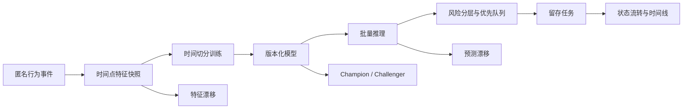

<div align="center">

# 用户行为特征平台与客户流失预测系统

从匿名行为事件、时间点特征和模型监控，到风险分层与留存任务闭环的数据产品。

[](https://github.com/ZliY221/customer-churn-feature-platform/actions/workflows/ci.yml)
[](https://github.com/ZliY221/customer-churn-feature-platform/actions/workflows/portable-smoke.yml)


[快速启动](#快速启动) · [业务流程](#业务流程) · [核心能力](#核心能力) · [项目文档](#项目文档) · [版本记录](CHANGELOG.md)

</div>

## 项目简介

平台以匿名客户行为事件为输入，按 `as_of_time` 构建时间点特征，完成逻辑回归模型训练、批量推理、漂移监控和延迟标签效果评估。预测结果进入客户风险分层与优先队列，并可创建、分派和跟踪留存任务，从而形成从数据准备到运营执行的闭环。

| 关注点 | 项目实现 |
| --- | --- |
| 特征工程 | 时间点快照、未来信息泄漏检查、版本化特征注册表 |
| 模型链路 | 时间切分训练、批量推理、Champion/Challenger 对比 |
| 模型监控 | 特征 PSI、预测分布、延迟标签效果和晋级建议 |
| 运营闭环 | 风险分层、客户优先队列、留存任务与状态时间线 |
| 可追溯性 | 输入指纹、模型哈希、预测编号和任务事件流水 |

## 快速启动

创建隔离运行时并执行完整演示链路：

```powershell
python scripts/bootstrap.py
```

结果位于 `build/quickstart/`，包含事件、特征快照、模型、预测批次、漂移报告、效果报告和模型对比结果。

完成数据流程后启动运营工作台：

```powershell
./scripts/api-up.ps1
```

访问 `http://127.0.0.1:8000/console`。

## 业务流程



## 核心能力

### 特征与模型

- 从登录、浏览、加购、成交和工单事件构建六期特征快照。
- 使用未来 30 天标签并检查特征时间边界，避免未来信息进入训练样本。
- 保存特征顺序、标准化参数、模型权重和数据指纹。

### 监控与比较

- 使用 PSI 监控特征与预测分布变化。
- 在标签成熟后计算分类、校准与覆盖指标。
- 在相同成熟标签批次下比较 Champion 与 Challenger，并输出可追溯建议。

### 留存运营

- 将预测概率映射为极高、高、关注和稳定四级风险。
- 支持创建留存任务、负责人分派、状态流转和重复保护。
- 支持按风险与负责人筛选任务，并查看完整状态时间线。
- 支持勾选多条任务批量重新分派，逐条保留负责人变更记录。
- 支持批量开始或完成留存任务，并为每条状态变化保留审计时间线。
- 批量操作即时反馈实际更新和跳过数量，便于确认幂等执行结果。
- 批量分派和状态推进在提交前显示变更预览，可取消误操作。
- 批量预览按风险等级和当前状态拆分影响范围，优先识别高风险任务。
- 新版批量工作流可在一次事务中同时完成负责人分派与任务启动。
- 高风险、终态和多字段批量变更会给出明确的重点确认原因。
- 预览汇总字段变化量、来源负责人范围和目标值，补充任务数之外的影响口径。
- 组合执行返回新增事件数量与事件游标范围，便于核对实时同步和审计完整性。
- 组合执行支持填写操作备注，并随审计回执返回，便于说明批量处置背景。
- 执行结果按四档风险统计影响范围，并突出极高风险与高风险任务数量。
- 根据实际变更与风险影响生成下一步动作和 4/24 小时复核窗口。
- 汇总回执、变更数量、高优先级数量、目标负责人和后续动作，生成实时交接摘要。
- 回执区分输入、唯一任务和重复选择数量，防止重复勾选影响判断。
- 后续动作按风险影响标记 P1、P2 或无需复核优先级。
- 为每次组合处置生成审计核对、负责人联系和复核安排清单。

### 数据与服务

- FastAPI 提供模型、预测、特征注册表、客户组合和任务接口。
- SQLite 保存运营任务和事件流水，不依赖外部数据库。
- 工作台集中展示模型血缘、风险分布、优先队列和任务进度。

## 工程结构

```text
config/                  特征注册表与监控策略
data/                    匿名样例数据
schemas/                 客户行为事件契约
scripts/                 启动、自检和流程入口
src/churn_platform/      特征、训练、推理、监控与 API
tests/                   数据链路与接口验证
docs/                    架构、模型和操作文档
```

## 常用入口

| 目标 | 命令或入口 |
| --- | --- |
| 核心环境检查 | `python scripts/project_doctor.py --profile core` |
| 完整建模流程 | `python scripts/quickstart.py` |
| 运营工作台 | `./scripts/api-up.ps1` |
| 特征一致性 | `check-feature-parity --help` |
| 漂移监控 | `monitor-churn-drift --help` |
| 模型比较 | `compare-churn-models --help` |

## 项目文档

- [用户使用指南](docs/user-guide.md)
- [运行环境分层](docs/runtime-environments.md)
- [系统架构](docs/architecture.md)
- [一键建模与监控流程](docs/quickstart.md)
- [特征注册表与一致性核对](docs/feature-registry-parity.md)
- [漂移监控](docs/drift-monitoring.md)
- [模型效果监控](docs/model-performance-monitoring.md)
- [Champion/Challenger 模型对比](docs/model-comparison.md)
- [留存运营工作台](docs/retention-operations.md)

## 运行边界

- 仓库仅使用匿名合成数据，不包含真实客户资料。
- 当前模型用于验证完整工程链路，不作为真实业务效果声明。
- 漂移告警表示分布达到策略阈值，不直接代表模型效果下降。
- 运营任务保存模型指纹和预测编号，确保后续仍可追溯决策来源。

## 版本与维护

当前版本为 `v2.15.0`。每次发布同步维护[用户使用指南](docs/user-guide.md)、[版本记录](CHANGELOG.md)和[版本摘要](VERSION_LOG.md)。
