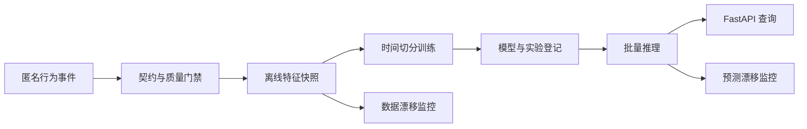

# 架构设计

## 时间边界

每个训练样本由三个时间段组成：历史上下文、特征观测窗口和未来标签窗口。特征计算函数接收显式 `as_of_time`，任何 `event_time > as_of_time` 的记录均不得进入特征。标签生成在独立步骤读取未来窗口，训练表合并前执行列级泄漏检查。

## 版本路线

1. 匿名事件契约与确定性生成器；
2. 时间点特征快照与标签生成；
3. 时间切分训练、基线模型和评估报告；
4. 实验登记、模型清单与可复现训练；
5. 批量推理、FastAPI 查询和漂移监控；
6. 容器化与持续集成验收。
