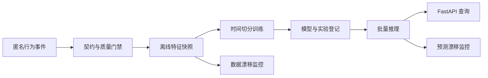

# 架构设计

## 时间边界

每个训练样本由三个时间段组成：历史上下文、特征观测窗口和未来标签窗口。特征计算函数接收显式 `as_of_time`，任何 `event_time > as_of_time` 的记录均不得进入特征。标签生成在独立步骤读取未来窗口，训练表合并前执行列级泄漏检查。

当前快照使用 30 天观测窗口 `(as_of_time - 30 天, as_of_time]` 和 30 天标签窗口 `(as_of_time, as_of_time + 30 天]`。只有截止时间前已出现的客户进入快照；未来窗口没有任何行为事件时，`churned_30d` 为 `true`。计数、活跃天数、最近活跃间隔、成交金额和购物车转化率均在同一时间边界内计算。

## 训练边界

训练、验证和测试集按 `as_of_time` 顺序切分，禁止随机打散跨越时间边界。标准化参数和模型权重只使用训练集拟合，决策阈值只使用验证集的 F1 选择，测试集只执行一次最终评估。报告包含 ROC-AUC、PR-AUC、精确率、召回率、F1、Brier score 和混淆矩阵；这些指标必须与具体数据指纹一起解释。

## 推理幂等性

批量推理严格校验训练时的特征顺序。`prediction_id` 由模型 SHA-256、匿名客户键和快照时间共同生成，同一模型处理同一快照时输出逐字节一致。批次清单记录输入、模型和输出指纹及记录数，文件通过临时文件替换写入，避免留下半成品。

## 版本路线

1. 匿名事件契约与确定性生成器；
2. 时间点特征快照与标签生成；
3. 时间切分训练、基线模型和评估报告；
4. 实验登记、模型清单与可复现训练；
5. 批量推理、FastAPI 查询和漂移监控；
6. 容器化与持续集成验收。
